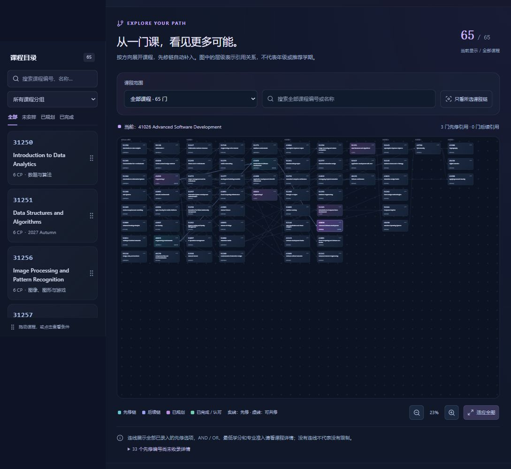

# CoursePlan · UTS 课程规划工作区

基于UTS官方2024历史课程资料的多专业课程规划原型，提供依赖图、学期安排、个人学分目标、本地账号、Ollama向量RAG和约束求解。

[在线演示](https://leoz-svg.github.io/courseplan/) · [开发日志 / 技术栈 / 挑战复盘](documentation/DEVELOPMENT_LOG.zh-CN.md) · [部署说明](documentation/DEPLOYMENT.md) · [保留的旧项目](https://github.com/leoz-svg/uts-course-planner)



## 当前功能

- 178门课程，按Program独立：信息技术65门、视觉传达设计61门、商科52门。
- 核心/方向/全部课程筛选、自动图布局、递归先修链/后续链、搜索、缩放和详情联动。
- 学期拖拽、卡片移除、完成状态、计划新建/切换/软删除恢复、撤销、JSON导入导出。
- 学习档案、目标CP、认可学分、已完成/已规划/尚需完成进度，学期选择2024—2030。
- 本地完整版：邮箱账号与Guest；SQLite账号计划；EmbeddingGemma向量检索与Qwen3候选选择；OR-Tools多方案规划。

## 在线与本地的区别

在线是GitHub Pages静态演示：使用Guest，无需注册；课程图、手动规划、规则检查、浏览器保存和导出可用。推荐明确采用浏览器关键词/词义匹配，未使用生成模型或向量RAG。自动规划页解释如何启动本地求解器，不展示伪造结果。

本地完整版提供全部Node接口、SQLite账号、Ollama向量RAG及Python自动规划。GitHub Pages不运行Node/Python，也不能访问开发者电脑的Ollama。个人资料和演示计划只保存在访问者自己的浏览器。

## 本地完整运行

需要Node.js22.13+、npm、Python3.10+；Ollama为AI功能可选依赖。本机验证环境为Node22.18、Python3.13。所有路径相对仓库根目录。

```powershell
npm ci
python -m venv .planner-venv
.\.planner-venv\Scripts\python.exe -m pip install -r scripts/planner-requirements.txt
Copy-Item .env.example .env.local
ollama pull qwen3:1.7b
ollama pull embeddinggemma
# 若Ollama尚未运行，在另一个终端执行 ollama serve
npm run build
npm run start -- --port 3010 --hostname 127.0.0.1
```

打开 http://localhost:3010/ 。不启动Ollama也可使用课程、手动规划及无兴趣描述的自动规划；AI会提示降级状态。完整自动规划依赖.planner-venv中安装的OR-Tools。

macOS/Linux将Python解释器路径改为`.planner-venv/bin/python`。也可通过`COURSEPLAN_PLANNER_PYTHON`指定已有环境。向量缓存默认为`.rag-index`，账号库为`.local-data/courseplan.sqlite`；这两个目录及.env.local都不提交Git。

修改页面时使用`npm run dev -- --port 3010 --hostname 127.0.0.1`。完整本地应用不需要公网Supabase密钥；可选只读课程视图详见.env.example，禁止把service-role密钥放到前端。

## 测试与构建

```powershell
npm test
npm run test:pathways
npm run lint:workspace
npm run typecheck
npm run build
npm run build:pages
```

静态构建在`.pages-build`隔离目录中完成，输出`.pages-build/out`，默认basePath为`/courseplan`。源码中的API目录不会被临时移走；本地账号与模型不参与静态构建。Pages工作流说明见[DEPLOYMENT.md](documentation/DEPLOYMENT.md)。

## 数据与模型

课程源为UTS Handbook2024历史页面，字段包含来源、学分、原始先修文字和审核状态。IT五方向与商科三方向的模块归属及科目证据保存在`app/data/catalog/expanded-program-*.json`；设计另有设计选修池与规则草案。采集脚本在`scripts/`，可通过HTTPS_PROXY设置自己的代理，默认直接连接，不关闭TLS校验。抓取缓存是中间文件，不进入发布版本。

生成模型为`qwen3:1.7b`，嵌入模型为`embeddinggemma`，768维余弦检索；索引是本地JSON缓存，不是pgvector。OR-Tools CP-SAT负责硬约束与多目标候选，独立audit复核后才显示。模型和依赖不包含在仓库下载中。

## 边界

这是独立原型，非UTS官方选课系统或校园认证。历史资料不保证当前开课或准入。IT/商科144CP阶段方案不代表满足全部毕业主修/模块；设计144CP草案存在108+24+12与108+18+18来源分配差异，需要校方确认。AND/OR图连线是探索引用，不能当作所有课程都必须修读。

## 项目归属与历史

本仓库为当前迭代的新版本，旧`uts-course-planner`保留。原项目README说明课程项目由Haoran Zheng与Meng Liu完成；当前迭代继续完善其课程规划方向，不抹去原团队成果。界面信息结构讨论参考Circles360项目，未将用户的视觉参考图片打包为资产。UTS资料及第三方依赖保留原权利与许可证，未擅自为全部历史源码追加新许可证。
